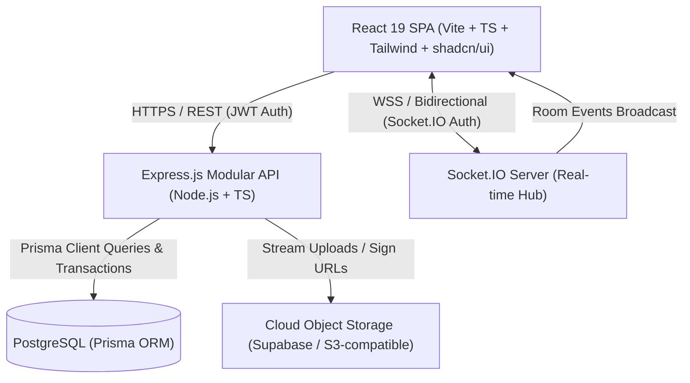
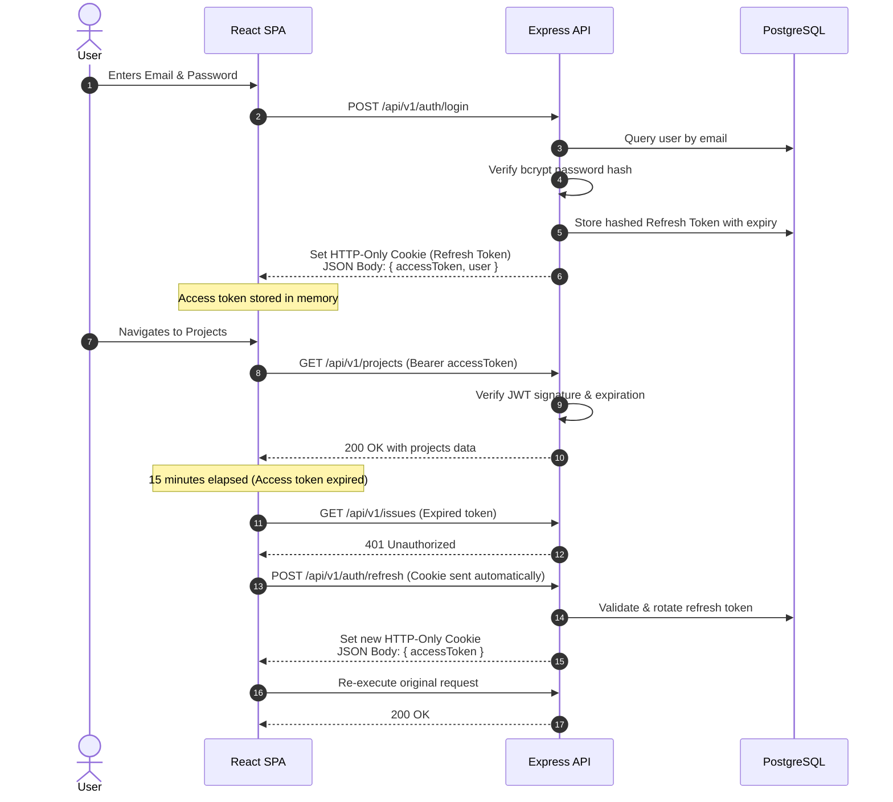

# FlowTrack — System Architecture Document

This document outlines the high-level system architecture, component boundaries, data flows, security design, and real-time event mechanisms for FlowTrack.

---

## 1. High-Level Architecture Overview

FlowTrack is built as a **Modular Monolith** using a TypeScript monorepo containing a modern React Single Page Application (SPA), a resilient Express.js REST & WebSocket API, and a shared domain package.



---

## 2. Monorepo Organization

```
flowtrack/
├── apps/
│   ├── web/                        # Frontend Single Page Application
│   │   ├── src/
│   │   │   ├── app/                # App initialization, Providers
│   │   │   ├── components/         # Shared UI components (shadcn/ui, layout)
│   │   │   ├── features/           # Feature modules (auth, projects, issues, kanban)
│   │   │   ├── hooks/              # Custom hooks (useSocket, useAuth, useDebounce)
│   │   │   ├── layouts/            # DashboardLayout, AuthLayout
│   │   │   ├── pages/              # Route page components
│   │   │   ├── routes/             # App routing and ProtectedRoute guards
│   │   │   ├── services/           # Axios HTTP client and API endpoints
│   │   │   ├── store/              # Redux Toolkit store and slices
│   │   │   └── types/              # Frontend types
│   │   ├── vite.config.ts
│   │   └── package.json
│   │
│   └── api/                        # Backend REST & WebSocket Server
│       ├── src/
│       │   ├── config/             # Environment, CORS, DB config
│       │   ├── middleware/         # Auth, RBAC, error handler, rate limiter
│       │   ├── modules/            # Domain modules (auth, projects, issues, etc.)
│       │   │   ├── auth/
│       │   │   ├── users/
│       │   │   ├── projects/
│       │   │   ├── issues/
│       │   │   ├── workflows/
│       │   │   ├── comments/
│       │   │   ├── time-logs/
│       │   │   ├── activities/
│       │   │   ├── notifications/
│       │   │   ├── saved-filters/
│       │   │   ├── tasks/
│       │   │   └── clients/
│       │   ├── sockets/            # Socket.IO connection and room handlers
│       │   ├── shared/             # Prisma client instance, custom AppError, logger
│       │   ├── app.ts              # Express application setup
│       │   └── server.ts           # HTTP server and Socket.IO initialization
│       ├── prisma/                 # Prisma schema, migrations, seed script
│       └── package.json
│
├── packages/
│   └── shared/                     # Shared TypeScript types, Zod schemas, constants
│       ├── src/
│       └── package.json
│
├── docs/                           # Architectural, design, and learning documentation
├── docker/                         # Dockerfiles for dev and production
├── docker-compose.yml              # Local PostgreSQL container definition
└── package.json                    # Monorepo workspaces definition
```

---

## 3. Backend Module Design (Modular Monolith)

Each domain module inside `apps/api/src/modules/` adheres to a strict separation of concerns:

```
modules/projects/
├── project.routes.ts       # Express router endpoints
├── project.controller.ts   # Request extraction, response status formatting
├── project.service.ts      # Core business rules, transactions, authorization logic
├── project.repository.ts   # Prisma database operations (queries, updates)
├── project.schema.ts       # Zod input validation schemas
└── project.types.ts        # TypeScript interfaces and DTOs
```

### Architectural Principles:
1. **Thin Controllers**: Controllers never contain business logic, database queries, or permission evaluations. They extract parameters, invoke services, and return standard JSON envelopes.
2. **Fat Services**: Services encapsulate transactions, validate domain rules (e.g. project key uniqueness, workflow transition validity), trigger notifications, and dispatch real-time events.
3. **Repository Abstraction**: Repositories isolate Prisma queries, avoiding N+1 query patterns by using selective `include` / `select` clauses.
4. **Strong Typing**: No arbitrary `any`. Input and output shapes are defined via Zod and TypeScript.

---

## 4. Authentication & Security Architecture

FlowTrack implements an enterprise-grade **dual-token authentication system**:



### Key Security Safeguards:
- **Refresh Token Rotation**: Each refresh request revokes the previous token and issues a new one. If an invalid or revoked token is reused, all tokens for that user session are invalidated (replay attack detection).
- **HTTP-Only Cookies**: Refresh tokens cannot be accessed via JavaScript (`document.cookie`), preventing XSS theft.
- **CSRF Protection & SameSite**: Cookies set with `SameSite: Lax` (or `None` with `Secure` for cross-site free hosting deployments) and origin validation.
- **Helmet**: Disables MIME sniffing, sets X-Frame-Options, enables XSS filter headers.
- **Rate Limiting**: `express-rate-limit` prevents brute-force attempts on login and register routes.

---

## 5. Real-Time Architecture (Socket.IO)

- Real-time updates do not replace REST APIs; the database remains the single source of truth.
- WebSocket handshakes authenticate using the current JWT access token.
- Users join `project:<projectId>` rooms when viewing project or issue pages.
- When an issue status changes, a comment is added, or an activity is recorded, the backend service broadcasts the event to the appropriate room.
- TanStack Query on the frontend intercepts socket events and invalidates or optimistically patches the cache.
