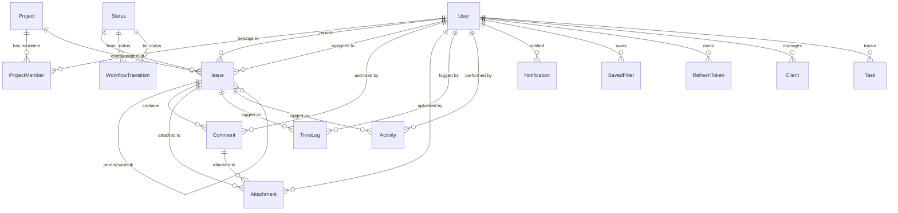

# FlowTrack — Database Design Specification (PostgreSQL + Prisma)

This document specifies the PostgreSQL relational schema, indexes, referential integrity constraints, and Prisma model definitions for FlowTrack.

---

## 1. Schema Diagram & Relationships

---

## 2. Table Specifications & Constraints

### 2.1 `users`
Represents application accounts and global roles.
- `id`: `String` (UUID / CUID), Primary Key.
- `name`: `String`, not null.
- `email`: `String`, unique, not null.
- `password`: `String` (bcrypt hash), not null.
- `role`: `Enum(ADMIN, MANAGER, USER)`, default `USER`, not null.
- `themePreference`: `String`, default `'light'`, not null (`'light' | 'dark'`).
- `emailVerifiedAt`: `DateTime?`, nullable.
- `deletedAt`: `DateTime?`, nullable (Soft delete).
- `createdAt`: `DateTime`, default `now()`.
- `updatedAt`: `DateTime`, auto-updated.
- **Indexes**:
  - `idx_users_email` (unique index on `email` where `deletedAt IS NULL`).
  - `idx_users_role` on `role`.

### 2.2 `projects`
Represents workspace projects.
- `id`: `String`, Primary Key.
- `name`: `String`, not null.
- `key`: `String`, unique, not null (Uppercase alphanumeric, max 10 chars).
- `description`: `String?`, text nullable.
- `isArchived`: `Boolean`, default `false`.
- `createdAt`: `DateTime`, default `now()`.
- `updatedAt`: `DateTime`, auto-updated.
- **Indexes**:
  - `idx_projects_key` (unique).
  - `idx_projects_created_at` (for descending sort).

### 2.3 `project_members`
Association table between users and projects with project-specific roles.
- `id`: `String`, Primary Key.
- `projectId`: `String`, references `projects(id)` ON DELETE CASCADE.
- `userId`: `String`, references `users(id)` ON DELETE CASCADE.
- `role`: `Enum(ADMIN, MEMBER)`, default `MEMBER`, not null.
- `createdAt`: `DateTime`, default `now()`.
- `updatedAt`: `DateTime`, auto-updated.
- **Constraints & Indexes**:
  - `uq_project_member`: UNIQUE (`projectId`, `userId`).
  - `idx_project_members_user_id` on `userId`.

### 2.4 `statuses`
Represents issue progress columns.
- `id`: `String`, Primary Key.
- `name`: `String`, unique, not null.
- `order`: `Int`, not null (determines column order on Kanban board).
- `createdAt`: `DateTime`, default `now()`.
- `updatedAt`: `DateTime`, auto-updated.
- **Initial Seed**:
  - Order 1: `To Do`
  - Order 2: `In Progress`
  - Order 3: `Done`

### 2.5 `workflow_transitions`
Enforces valid state transition paths.
- `id`: `String`, Primary Key.
- `fromStatusId`: `String`, references `statuses(id)` ON DELETE CASCADE.
- `toStatusId`: `String`, references `statuses(id)` ON DELETE CASCADE.
- `createdAt`: `DateTime`, default `now()`.
- **Constraints & Indexes**:
  - `uq_workflow_transition`: UNIQUE (`fromStatusId`, `toStatusId`).

### 2.6 `issues`
Represents trackable work items, bugs, and tasks.
- `id`: `String`, Primary Key.
- `projectId`: `String`, references `projects(id)` ON DELETE CASCADE.
- `parentId`: `String?`, references `issues(id)` ON DELETE SET NULL (self-referencing for epics/subtasks).
- `title`: `String`, not null.
- `description`: `String?`, text nullable.
- `type`: `Enum(BUG, TASK, FEATURE)`, default `TASK`.
- `priority`: `Enum(LOW, MEDIUM, HIGH)`, default `MEDIUM`.
- `statusId`: `String`, references `statuses(id)` ON DELETE RESTRICT.
- `assigneeId`: `String?`, references `users(id)` ON DELETE SET NULL.
- `reporterId`: `String`, references `users(id)` ON DELETE CASCADE.
- `createdAt`: `DateTime`, default `now()`.
- `updatedAt`: `DateTime`, auto-updated.
- **Indexes**:
  - `idx_issues_project_status` on (`projectId`, `statusId`).
  - `idx_issues_assignee` on `assigneeId`.
  - `idx_issues_reporter` on `reporterId`.
  - `idx_issues_parent` on `parentId`.
  - `idx_issues_priority` on `priority`.

### 2.7 `comments`
Discussions on an issue.
- `id`: `String`, Primary Key.
- `issueId`: `String`, references `issues(id)` ON DELETE CASCADE.
- `userId`: `String`, references `users(id)` ON DELETE CASCADE.
- `content`: `String`, text not null.
- `createdAt`: `DateTime`, default `now()`.
- `updatedAt`: `DateTime`, auto-updated.
- **Indexes**:
  - `idx_comments_issue_created` on (`issueId`, `createdAt` ASC).

### 2.8 `attachments`
Uploaded files linked to issues or comments.
- `id`: `String`, Primary Key.
- `issueId`: `String?`, references `issues(id)` ON DELETE CASCADE.
- `commentId`: `String?`, references `comments(id)` ON DELETE CASCADE.
- `userId`: `String`, references `users(id)` ON DELETE CASCADE.
- `fileName`: `String`, original filename.
- `fileKey`: `String`, object key in cloud storage.
- `fileUrl`: `String`, public or signed download URL.
- `mimeType`: `String`.
- `fileSize`: `Int` (in bytes).
- `createdAt`: `DateTime`, default `now()`.

### 2.9 `time_logs`
Work logs logged against issues.
- `id`: `String`, Primary Key.
- `issueId`: `String`, references `issues(id)` ON DELETE CASCADE.
- `userId`: `String`, references `users(id)` ON DELETE CASCADE.
- `timeSpent`: `Int`, in minutes (must be >= 1).
- `description`: `String?`, nullable.
- `logDate`: `DateTime`, not null.
- `createdAt`: `DateTime`, default `now()`.
- **Indexes**:
  - `idx_time_logs_issue` on `issueId`.
  - `idx_time_logs_user` on `userId`.

### 2.10 `activities`
Audit log of modifications on issues.
- `id`: `String`, Primary Key.
- `issueId`: `String`, references `issues(id)` ON DELETE CASCADE.
- `userId`: `String`, references `users(id)` ON DELETE CASCADE.
- `action`: `String`, e.g., `'updated status'`, `'updated assignee'`, `'updated priority'`.
- `oldValue`: `String?`, human-readable previous value.
- `newValue`: `String?`, human-readable new value.
- `createdAt`: `DateTime`, default `now()`.
- **Indexes**:
  - `idx_activities_issue_created` on (`issueId`, `createdAt` DESC).

### 2.11 `notifications`
System alerts for assignments and activity.
- `id`: `String`, Primary Key.
- `userId`: `String`, references `users(id)` ON DELETE CASCADE.
- `type`: `String`, e.g., `'ISSUE_ASSIGNED'`, `'COMMENT_ADDED'`.
- `title`: `String`.
- `message`: `String`.
- `data`: `Json?`, holds `{ issueId, projectId, url }`.
- `readAt`: `DateTime?`, nullable.
- `createdAt`: `DateTime`, default `now()`.
- **Indexes**:
  - `idx_notifications_user_read` on (`userId`, `readAt`).

### 2.12 `saved_filters`
User-defined custom issue filters.
- `id`: `String`, Primary Key.
- `userId`: `String`, references `users(id)` ON DELETE CASCADE.
- `name`: `String`.
- `filterData`: `Json` (object containing search, statusId, priority, assigneeId, etc.).
- `createdAt`: `DateTime`, default `now()`.

### 2.13 `refresh_tokens`
Durable session tokens for JWT rotation.
- `id`: `String`, Primary Key.
- `userId`: `String`, references `users(id)` ON DELETE CASCADE.
- `tokenHash`: `String`, unique, SHA-256 hash of refresh token.
- `expiresAt`: `DateTime`.
- `revokedAt`: `DateTime?`.
- `ipAddress`: `String?`.
- `userAgent`: `String?`.
- `createdAt`: `DateTime`, default `now()`.
- **Indexes**:
  - `idx_refresh_tokens_hash` on `tokenHash`.

### 2.14 `clients` & `tasks` (Legacy tabular tracker)
- `clients`: `id`, `name`, `userId`, `deletedAt`, timestamps.
- `tasks`: `id`, `userId`, `client`, `taskBugName`, `owner`, `priority`, `startDate`, `endDate`, `devStatus`, `unitTestStatus`, `stagingStatus`, `prodStatus`, `comment`, `deletedAt`, timestamps.
