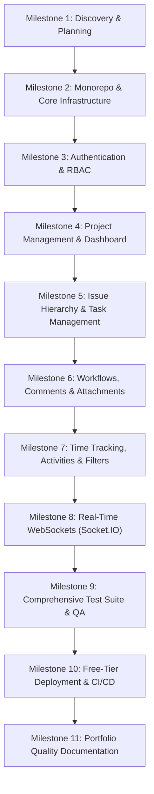

# FlowTrack — Incremental Implementation Plan & Git Commit Checkpoints

This document defines the chronological development sequence, technical dependencies, testing strategy, and Git commit checkpoints for building FlowTrack.

---

## Development Milestones Overview

---

## Detailed Milestone Breakdown

### Milestone 1 — Discovery, Planning & Repo Initialization
- **Goal**: Thoroughly inspect the Laravel repository, extract all business rules and schemas, produce architectural and planning documents, and initialize a pristine Git repository.
- **Deliverables**:
  - `docs/FEATURE_INVENTORY.md`
  - `docs/OLD_TO_NEW_MAPPING.md`
  - `docs/DATABASE_DESIGN.md`
  - `docs/API_DESIGN.md`
  - `docs/IMPLEMENTATION_PLAN.md`
  - `docs/ARCHITECTURE.md`
  - Fresh git repository with clean `.gitignore`.
- **Commit Checkpoints**:
  - `chore: initialize repository and clean gitignore`
  - `docs: add comprehensive analysis and migration planning documentation`

---

### Milestone 2 — Foundation & Monorepo Setup
- **Goal**: Establish the monorepo structure with npm workspaces, TypeScript configurations, Express backend skeleton, React + Vite frontend skeleton, Prisma ORM setup, and local Docker Compose.
- **Deliverables**:
  - Root `package.json` with workspaces (`apps/web`, `apps/api`, `packages/shared`).
  - Shared package with common types, validation schemas, and constants.
  - Express API with Pino structured logging, centralized error handler, and `/health` route.
  - Prisma schema with initial PostgreSQL models, migrations, and database seed script.
  - React + Vite SPA with Tailwind CSS, Lucide icons, and routing skeleton.
  - Docker Compose for local PostgreSQL 16.
- **Commit Checkpoints**:
  - `chore: initialize TypeScript monorepo with web, api, and shared workspaces`
  - `feat(db): configure Prisma schema, migrations, and database seeder`
  - `feat(api): set up Express application skeleton with health check and error middleware`
  - `feat(web): configure Vite, React, Tailwind CSS, and base routing layout`

---

### Milestone 3 — Authentication & RBAC
- **Goal**: Implement dual-token JWT authentication, HTTP-only refresh token cookies with rotation, password hashing with bcrypt, role-based access control middleware, and profile management.
- **Deliverables**:
  - Backend: `/api/v1/auth/register`, `/login`, `/refresh`, `/logout`, `/users/me`.
  - Refresh token persistence and reuse-detection in PostgreSQL.
  - Global roles: `ADMIN`, `MANAGER`, `USER`.
  - Frontend: Login, Register, Profile, Theme switcher, Redux auth slice, Axios interceptor for automatic token refresh.
  - Protected route wrappers.
- **Commit Checkpoints**:
  - `feat(auth): implement backend JWT authentication, refresh token rotation, and RBAC`
  - `feat(auth): add frontend authentication pages, state management, and route guards`

---

### Milestone 4 — Core Project Management & Analytics Dashboard
- **Goal**: Implement project CRUD operations, project membership roles, and the real-time aggregated dashboard.
- **Deliverables**:
  - Backend: Project routes, controller, service, repository, member management.
  - Dashboard stats service: total issues, status breakdown, type distribution, top users, logged time, bottleneck detection.
  - Frontend: Projects list, Project details, Add/Remove member dialog, Dashboard view with Recharts visualizations.
- **Commit Checkpoints**:
  - `feat(projects): implement project management APIs and membership controls`
  - `feat(dashboard): add aggregated statistics API for project and issue analytics`
  - `feat(projects): build project management UI and member management flows`
  - `feat(dashboard): build dashboard UI with analytics charts and metrics cards`

---

### Milestone 5 — Issue Management, Hierarchy & Legacy Task Tracker
- **Goal**: Build full issue management with epics/subtasks hierarchy, search, multi-faceted filtering, and preserve legacy task/client tracker features.
- **Deliverables**:
  - Backend: Issue CRUD, parent-child relationship handling, search and filter queries, clients and tasks CRUD.
  - Frontend: Issues table with filtering toolbar, issue creation modal, subtask creator, legacy tabular task view with autosuggest.
- **Commit Checkpoints**:
  - `feat(issues): implement issue CRUD and parent-child hierarchy APIs`
  - `feat(tasks): implement legacy client and tabular task tracker APIs`
  - `feat(issues): build issue list, filtering controls, and issue creation dialog`
  - `feat(tasks): build tabular task tracker and client directory UI`

---

### Milestone 6 — Workflows, Kanban Board, Comments & Attachments
- **Goal**: Implement configurable workflow statuses and transitions, drag-and-drop Kanban board, discussion comments, and cloud object storage for file attachments.
- **Deliverables**:
  - Backend: WorkflowService transition validation, Comments service with notification triggers, Multer upload handler for attachments.
  - Frontend: Interactive Kanban board with drag-and-drop and transition rejection rollback, Issue detail page with comment thread and attachment viewer.
- **Commit Checkpoints**:
  - `feat(workflows): implement workflow status transition validation engine`
  - `feat(comments): add comment discussions and file attachment storage`
  - `feat(kanban): build interactive Kanban board with optimistic status updates`
  - `feat(issues): build comprehensive issue detail view with comments and attachments`

---

### Milestone 7 — Productivity Features (Time Tracking, Activities, Saved Filters)
- **Goal**: Add work logging, automatic activity audit timeline, saved user views, and user preferences.
- **Deliverables**:
  - Backend: Time logs service, automated activity logger hook on issue changes, saved filter CRUD.
  - Frontend: Time logging modal and summary, chronological activity timeline, quick-access saved filter dropdown.
- **Commit Checkpoints**:
  - `feat(time-tracking): implement work time logging and aggregation`
  - `feat(activity): implement automated issue change history and audit timeline`
  - `feat(filters): implement saved filters for custom issue views`

---

### Milestone 8 — Real-Time WebSocket Infrastructure (Socket.IO)
- **Goal**: Enable live notifications and instant collaborative updates across connected users without full-page reloads.
- **Deliverables**:
  - Backend: Authenticated Socket.IO server, room subscriptions (`project:<id>`, `user:<id>`), event emitters on issue/comment/status changes.
  - Frontend: `useSocket` hook, live toast alerts, real-time board update synchronization.
- **Commit Checkpoints**:
  - `feat(realtime): configure Socket.IO server with JWT authentication and project rooms`
  - `feat(realtime): integrate frontend real-time updates and live notification badges`

---

### Milestone 9 — Quality Assurance & Testing Suite
- **Goal**: Ensure high code quality, test coverage, and regression safety across backend and frontend.
- **Deliverables**:
  - Backend: Vitest + Supertest integration tests for auth, workflow validation, project membership RBAC, and issue lifecycle.
  - Frontend: Vitest + React Testing Library tests for authentication forms, issue cards, and kanban interactions.
  - End-to-end: Playwright test suite for critical user journeys.
- **Commit Checkpoints**:
  - `test(api): add unit and integration test suite for backend services and controllers`
  - `test(web): add component and integration tests for frontend UI`
  - `test(e2e): configure Playwright end-to-end test suite for core workflows`

---

### Milestone 10 — Free-Tier Deployment & CI/CD Pipeline
- **Goal**: Configure the application for deployment on 100% free hosting tiers (Render, Vercel, Supabase) and setup GitHub Actions CI.
- **Deliverables**:
  - Dockerfile & docker-compose configurations.
  - `render.yaml` for backend deployment.
  - `vercel.json` for frontend SPA routing.
  - GitHub Actions CI workflow for linting, type-checking, and test automation.
  - Step-by-step deployment guide in `docs/FREE_HOSTING_DEPLOYMENT.md`.
- **Commit Checkpoints**:
  - `ci: add GitHub Actions workflow for typecheck, lint, and test verification`
  - `deploy: add Dockerfiles, render.yaml, and vercel.json for free-tier hosting`
  - `docs: add comprehensive free-tier hosting deployment guide`

---

### Milestone 11 — Documentation & Final Portfolio Polish
- **Goal**: Complete all educational walkthroughs, architecture diagrams, interview talking points, and root README.
- **Deliverables**:
  - Professional root `README.md`.
  - `docs/LEARNING_GUIDE.md` & `docs/IMPORTANT_CONCEPTS.md`.
  - `docs/GIT_HISTORY.md` summarizing the development narrative.
- **Commit Checkpoints**:
  - `docs: finalize system documentation, learning guides, and portfolio README`
